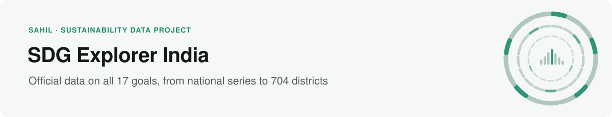
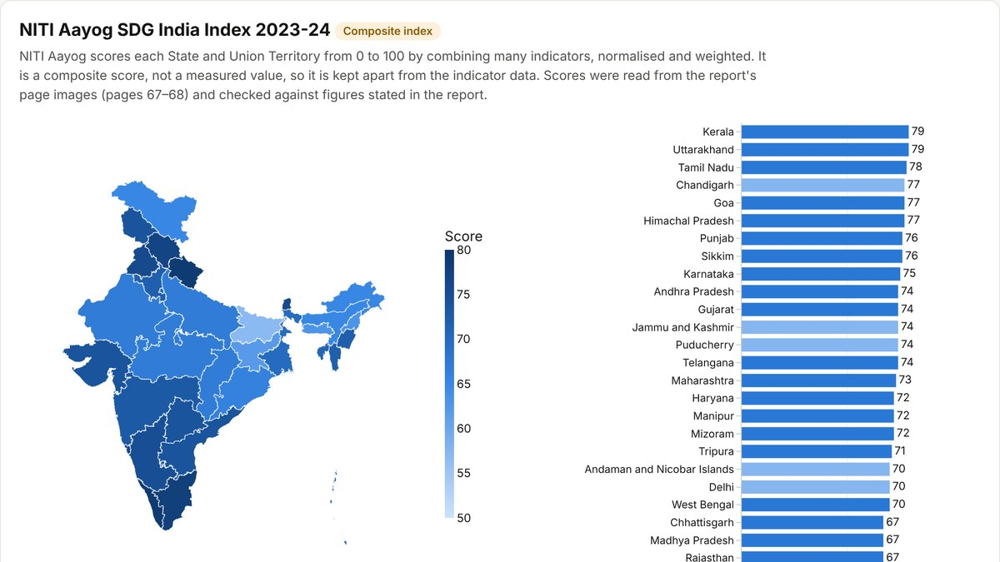

<picture>
  <source media="(prefers-color-scheme: dark)" srcset="assets/header-sdg-dark.svg">
  
</picture>

[](https://github.com/sahiljangra12/sdg-explorer-india/actions/workflows/ci.yml)

How is India doing on the 17 UN Sustainable Development Goals, and where is data missing? This project brings together four official sources: the UN Global SDG Indicators Database, MoSPI's National Indicator Framework report, NITI Aayog's SDG India Index and the National Family Health Survey district fact sheets. A tested Python pipeline downloads, checks and cleans them, and a website lets anyone explore the result. Every value links back to the official file it came from, and missing data stays missing.

**[Open the explorer →](https://sahiljangra12.github.io/sdg-explorer-india/)** · [Methods](docs/METHODS.md) · [Coverage report](docs/COVERAGE.md) · [Download the data](data/processed/)

<a href="https://sahiljangra12.github.io/sdg-explorer-india/"></a>

**At a glance:** 51,700 observations · all 17 goals · 312 indicators · 751 data series · India and 704 districts · 1977–2026

## The website

`docs/index.html` is a static page served by GitHub Pages. It reads small JSON files in `docs/data/`, which `python -m sdg_india build` (or `python -m sdg_india site`) writes from `data/processed/`. The page computes nothing new: it shows the processed values, statuses and labels as they are, and a test checks that every national and district value on the site matches `data/processed/observations.csv`.

| Page | What it shows |
|---|---|
| Home | The 17 goals as colour tiles in the official SDG colours, with how many data series each has and how many of the UN's series have India data |
| Goal pages (one per goal) | Every national series for that goal as a card with India's latest published value and a small trend line. Opening a card shows all values as a table; "Plot over time" draws the trend when at least 3 years have values (lines join consecutive years only). Breakdowns, definition, original source, footnotes, CSV download |
| States & UTs | NITI Aayog SDG India Index 2023-24: map and ranking of the 36 States/UTs; India's scores by edition and goal. Labelled as a composite index |
| Compare districts | 704 districts, 34 NFHS indicators. Filters: State/UT, poverty level (fifths of districts by NITI Aayog's MPI headcount ratio) and Aspirational District status. Spread of the indicator, poverty vs indicator scatter (Spearman rank correlation, flags indicators that are part of the poverty index), box plots by group, and a side-by-side profile of up to four districts against the all-district range |
| Data gaps | UN series with and without India data, a series-by-year grid per goal, MoSPI tables not parsed, district values not read, and coverage across all goals |
| Sources | Source register, validation report, data rules, links to the full tables |

Each page has its own link (for example `#goal-6`, `#gaps-13`, `#districts`), so a view can be shared directly.

To view it locally: `cd docs && python3 -m http.server 8000`, then open http://localhost:8000.

## Start on a Mac (one command)

Open Terminal in this folder and run:

```bash
bash run_mac.command
```

Or double-click `run_mac.command` in Finder (if macOS blocks it, right-click → Open). It finds Python 3.11 or newer, creates a private environment in `.venv`, installs the dependencies, updates the data from the official sources (or uses the verified files bundled here if you are offline), runs the tests, and opens the dashboard at http://localhost:8501.

Requires Python 3.11+. macOS's built-in `python3` is usually 3.9; if so, install Python from [python.org](https://www.python.org/downloads/macos/) or with `brew install python@3.12`.

> **Note on the bundled files.** The source PDFs (NITI Aayog report, 24 MB; MoSPI report, 37 MB; 704 NFHS district fact sheets, about 470 MB) are not included in the download, to keep it small. Everything verified from them is included in `data/reference/`, so the dashboard works without them. `bash run_mac.command` (or `python -m sdg_india fetch`) downloads the two reports from the official sites. To re-parse the PDFs on your Mac, install Poppler once with `brew install poppler`; without it, the verified extracts are used.

## What the data contains

Full, automatically generated figures are in [docs/COVERAGE.md](docs/COVERAGE.md). In this build: **51,700 observations from three official sources, all 17 goals, 1977–2026, for India and 704 districts**, plus 98 composite index scores kept separately.

| | Status | Coverage |
|---|---|---|
| **UN Global SDG Indicators Database** (national) | ✅ Verified | 12,469 observations, 212 global indicators, 493 series, all 17 goals, 1977–2026 (5,255 before 2015). City breakdowns for 91 cities in 6 urban series. |
| **NITI Aayog SDG India Index 2023-24** (composite index) | ✅ Verified, kept separate | 98 published scores: 36 State/UT composite scores, India's composite score for 4 editions (2018–2023-24), and India's 58 goal scores. |
| **MoSPI NIF Progress Report 2025** (national time series) | ✅ Verified | 1,886 values for 224 of the 277 national indicators in the report's Data Snapshot, all 17 goals. The other 53 are listed with reasons in `data/processed/not_parsed.csv`. |
| **NFHS-5 District Fact Sheets** (MoHFW / IIPS) | ✅ Verified against an independent digitisation | 43,359 rows: 34 SDG-linked indicators for 704 districts in 34 States/UTs, NFHS-5 (2019-21) and NFHS-4 (2015-16). Goals 2, 3, 4, 5, 6, 7, 16, 17. |
| **NITI Aayog National MPI 2023, district tables** (district grouping) | ✅ Verified, kept separate | Headcount ratio, intensity and MPI for NFHS-4 and NFHS-5, 709 rows; all 704 NFHS districts matched. Used only to group and filter districts. |
| **NITI Aayog Aspirational Districts list** (district grouping) | ✅ Loaded | 112 districts; 108 linked to NFHS districts (4 were created after NFHS-5). |

How the data were verified:
- **UN data.** The API reported 14,594 records for India. All were received, across 15 complete pages. 1,181 were exact repeats: series filed under several indicators are returned once per indicator. These were merged only after checking that their content was identical. 944 records are the UN's own "NaN = Not Available" markers; they are kept for the missing-data analysis but not counted as observations. A test traces 300 random processed values back to the raw files byte for byte.
- **MoSPI data.** Tables were parsed only when every row and column could be read unambiguously. Tables with multi-line headers, hidden grouping columns (such as quarters) or garbled layout were skipped and listed rather than guessed. Every one of the 1,303 parsed table rows was then checked by a second, independent method: the period and its values must appear together on the printed page, using pdfplumber's word positions. 1,302 passed; 1 (`1.3.2`, 2023-24 = 54.82) is a word pdfplumber cannot extract, and was confirmed on the rendered page image. Column alignment of multi-column tables with "-" cells was also checked against the rendered page. 23 further tables, with multi-line headers or grouping columns, were read from their drawn gridlines (pdfplumber) instead: 392 values. Their column labels were reviewed on the page images, every row was confirmed against Poppler's text layout, and where both parsers can read a table they agree on all 773 shared rows.
- **NFHS district data.** The fact sheets were read from the PDF text layer. Each indicator was matched by its name, not only its printed number. This matters because two official sheets (Mahisagar, Wardha) skip a number in their list. Values in brackets (25–49 cases) are kept, with a note. `na` and `*` are kept as "not available". 13 values in 9 sheets, whose numbers were split across lines out of column order, were left out and listed. The result was compared with an independent digitisation of the same fact sheets (pratapvardhan/NFHS-5, CC BY 4.0): 20,409 of 20,413 shared values are identical, and the 4 differences are a column shift in that copy (Dhule), not in this one. **Pending:** the 704 PDFs came from a public GitHub mirror (SaiSiddhardhaKalla/NFHS), because the official IIPS site was not reachable from the build machine. Their file checksums still need comparing with copies downloaded directly from rchiips.org.
- **NITI Aayog MPI district tables.** Some pages of the report carry an invisible copy of a neighbouring State's table under the printed one (Assam's districts under Bihar's). Text covered by shapes drawn later is removed before reading. Every row must satisfy MPI = headcount ratio × intensity within rounding, and a second reader (Poppler) shows the same six values on one line for every row outside the Bihar page; Bihar's 38 rows, where Poppler mixes in the hidden copy, were checked against the rendered page image. District names were matched within each State by name, then through a reviewed alias list (`data/reference/niti_mpi_district_aliases.csv`); districts that were split or merged are not matched to anything.
- **NITI scores.** Each score was read from the report's page images (pages 67–68). They were cross-checked against figures the report states in its text (for example State range 57–79; Goal 13 rose from 54 to 67). Two independent readings agreed. The "change since 2020-21" labels were not legible enough at the report's resolution and are not included.

## The Streamlit dashboard (local)

The same data can also be explored in a local Streamlit app (`bash run_mac.command` opens it).


| Tab | What it shows |
|---|---|
| Indicator explorer | National series. Pick a goal and series. Trend chart with every published value, breakdowns (sex, age, urban/rural, cities and so on), the official definition, original data source, release, footnotes, and a CSV download. |
| States & UTs | Choropleth map and ranking of the NITI Aayog composite scores, India's score by edition and by goal. Clearly labelled as a composite index. |
| Districts | Pick an NFHS indicator. For all of India: the spread across districts, with the 15 lowest and highest. For one State/UT: every district ranked, with NFHS-4 → NFHS-5 change. CSV download. No State averages are made up from district values. |
| Missing data | For each goal: how many UN series have India data and how many do not, a year-by-series grid of gaps, the coverage table, the UN series with no India data, the MoSPI indicators that were not parsed (with reasons and report pages), and district values that could not be read. |
| Goal overview | Series with data per goal (official SDG colours) and a goal-by-year coverage grid. |
| Data & downloads | Search and download the filtered data, all observations, indicator metadata, index scores and the source register. |
| Sources & methods | Source register with status, validation report and the data rules. |

## Pipeline

```bash
python -m sdg_india fetch            # download every source (cached; retries; checks completeness)
python -m sdg_india fetch --refresh  # download again even if cached (atomic: a failed refresh keeps the old data)
python -m sdg_india import <folder>  # import official files downloaded in a browser or with curl
python -m sdg_india build            # rebuild data/processed from data/raw, validate, write docs/COVERAGE.md
python -m sdg_india all              # fetch, then build
python -m sdg_india report           # print the coverage manifest
streamlit run app/app.py             # open the dashboard
python -m sdg_india site             # rewrite the website data in docs/data
python -m pytest                     # run the tests
```

The pipeline:

- **Downloads.** Retries with exponential back-off on connection errors and HTTP 429/5xx responses.
- **Provenance.** Each file has a record: URL, time, size, SHA-256.
- **Completeness.** Every UN page must be present and the record count must match the API's total. PDFs are checked for an end-of-file marker.
- **Validation.** Every build is validated, and errors stop the build while keeping the previous one in place. See [docs/METHODS.md](docs/METHODS.md) for the schema and every rule.

## Project structure

```
sdg_india/                 Python package
  config.py                source register, goal names, paths
  geography.py             India + 36 States/UTs + former UTs, with spelling variants
  http.py                  downloads with retries, cache, provenance, PDF integrity check
  io.py                    reads processed tables without altering published text
  sources/un_sdg.py        UN SDG API: pagination, completeness, parsing, breakdowns
  sources/niti.py          NITI Aayog SDG India Index (composite scores)
  sources/mospi.py         MoSPI NIF Progress Report: strict table parsers and independent verification
  sources/nfhs.py          NFHS-5 district fact sheets: name-matched indicators, SDG mapping
  validate.py, build.py    validation rules, assembly, coverage report
  geo.py                   state boundaries for the map
  site.py                  exports the processed data for the website
app/app.py                 Streamlit dashboard
data/raw/                  official files exactly as downloaded, with .meta.json provenance records
data/reference/            NITI index scores (verified, with page references); verified MoSPI and NFHS extracts
data/processed/            observations, indicators, coverage, index scores, geographies, sources, manifest
data/geo/                  simplified State/UT boundaries (DataMeet, CC BY 4.0)
docs/                      website (index.html + data/), METHODS.md, COVERAGE.md
tests/                     68 tests (synthetic fixtures are clearly marked and never written to data/)
run_mac.command            one-command setup and launch
```

## Data rules (short version)

Nothing is invented, imputed or interpolated. Values are kept exactly as published. Composite index scores never mix with raw indicator data. Observation years are kept separate from publication dates. Breakdowns are preserved, and pre-2015 values are kept as published. Details: [docs/METHODS.md](docs/METHODS.md).

## Sources and licences

- UN Statistics Division, [Global SDG Indicators Database](https://unstats.un.org/sdgs/dataportal/database), via the [SDG API](https://unstats.un.org/sdgapi/swagger/)
- NITI Aayog, [SDG India Index 2023-24](https://www.niti.gov.in/sites/default/files/2024-07/SDG_India_Index_2023-24.pdf)
- MoSPI, [SDG National Indicator Framework Progress Report 2025](https://www.mospi.gov.in/sites/default/files/publication_reports/Sustainable%20Development%20Goals%20National%20Indicator%20Framework%20Progress%20Report%2C%202025.pdf) and the [MoSPI SDG portal](https://mospi.gov.in/sdg)
- Ministry of Health and Family Welfare / IIPS, [NFHS-5 District Fact Sheets](http://rchiips.org/nfhs/districtfactsheet_NFHS-5.shtml); files obtained from the [SaiSiddhardhaKalla/NFHS](https://github.com/SaiSiddhardhaKalla/NFHS) mirror; cross-checked with [pratapvardhan/NFHS-5](https://github.com/pratapvardhan/NFHS-5) (CC BY 4.0)
- State boundaries: [DataMeet India community](https://github.com/datameet/maps) (CC BY 4.0), simplified; illustrative, not an authoritative depiction of India's borders

The code is under the [MIT License](LICENSE). The data remain subject to each publisher's terms of use.
